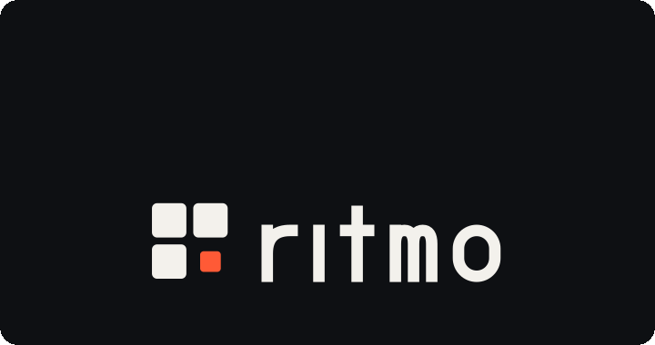

<p align="center">
  <picture>
    <source media="(prefers-color-scheme: dark)" srcset="./brand/assets/ritmo-lockup-padded-inverse.svg">
    
  </picture>
</p>

# Ritmo

The agent-first type safe ECS runtime

You direct the mechanics and feel. Your coding agent builds the simulation with
closed schemas, declared system access, explicit schedule boundaries, and typed
services. Compile-time checks reject undeclared access and missing requirements;
headless sessions expose lints, invariants, journals, and the causes of changes.

Ritmo works with your renderer and game loop. Its packages provide simulation,
input, timing, math, and renderer bridges. Drawing stays in the game.

<p align="center">
  <picture>
    <source media="(prefers-reduced-motion: reduce)" srcset="./brand/assets/ritmo-motion-still.svg">
    
  </picture>
</p>

New to the library? Start with [CONCEPTS.md](./CONCEPTS.md) (the model in five
minutes), then [GAME_API.md](./GAME_API.md). Type architecture and storage are
documented in [ARCHITECTURE.md](./ARCHITECTURE.md).

```sh
pnpm add @typeonce/ritmo
```

Requires TypeScript 5.9 or newer. The type tests run on every TypeScript
version from 5.9 up, and the packages build with TypeScript 7.

| Package | Contents |
|---|---|
| `@typeonce/ritmo` | The ECS runtime |
| `@typeonce/ritmo-math` | Validated vectors, sizes, and bounding boxes; swept collision, spatial grid, flow field, deterministic random |
| `@typeonce/ritmo-browser` | Fixed-step loop, keyboard, pointer, and touch input, input capture |
| `@typeonce/ritmo-render` | Entity to renderer node sync, for any renderer |
| `@typeonce/ritmo-pixi` | Pixi container adapter (`PixiNodeRegistry.make`) |
| `@typeonce/ritmo-devtools` | Headless debug sessions and trace reports ([README](./packages/devtools/README.md)) |

All packages are released together with the same version.

```ts
import { Descriptor, Schema } from "@typeonce/ritmo"

// Define the ECS world shape once.
const Position = Descriptor.Component<{ x: number; y: number }>()("Position")
const Velocity = Descriptor.Component<{ x: number; y: number }>()("Velocity")
const DeltaTime = Descriptor.Resource<number>()("DeltaTime")

// Bind the schema to its game-facing APIs.
const Game = Schema.bind(Schema.fragment({ components: { Position, Velocity }, resources: { DeltaTime } }))

// Systems only receive the access they declare here.
const Move = Game.System("Move", {
  queries: { moving: Game.Query({ selection: { position: Game.Query.write(Position), velocity: Game.Query.read(Velocity) } }) },
  resources: { deltaTime: Game.System.readResource(DeltaTime) }
}, ({ queries, resources }) => {
  for (const match of queries.moving.each()) {
    const position = match.data.position.get()
    const velocity = match.data.velocity.get()
    match.data.position.set({ x: position.x + velocity.x * resources.deltaTime.get(), y: position.y + velocity.y * resources.deltaTime.get() })
  }
})

const runtime = Game.Runtime.make({
  services: Game.Runtime.services(),
  resources: { DeltaTime: 1 / 60 }
})
runtime.tick(Game.Schedule(Move))
```

Start with the [Pixi walkthrough](./scripts/homepage.md) for the full step-by-step example.

## Runtime semantics

- Descriptor identity is `(kind, name)`. A bound schema rejects two descriptors of one kind with the same name at compile time, and a look-alike descriptor with a different value type is not accepted in place of the registered one.
- Structural changes are never applied implicitly. Queued commands and machine transitions stay pending, across schedule runs if needed, until a schedule reaches `applyDeferred()` or `applyStateTransitions(...)`.
- Reads are per system: `added(...)`/`changed(...)` filters, removed/despawned reads, events, transition events, and relation failures show each system what was published since its own previous run, exactly once.
- Query results come back in spawn order.

## Performance

Queries only visit entities that carry their rarest required component, cache their match set until a component or relation they depend on changes membership, and reuse match objects between runs. See [ARCHITECTURE.md](./ARCHITECTURE.md#storage).

The benchmark suite in [`packages/core/bench`](./packages/core/bench) covers spawn/despawn, query iteration, change detection, structural churn, schedule overhead, lookups, events, relations, and type-checker cost; [`packages/math/bench`](./packages/math/bench) and [`packages/render/bench`](./packages/render/bench) cover per-frame vector math, swept collision, spatial grid, flow field, random, input axes, and render sync:

```sh
pnpm bench          # run and print
pnpm bench:check    # compare with packages/core/bench/baseline.json (exit 1 on regression)
pnpm bench:update   # record a new baseline
```

CI measures every pull request against its base commit on the same runner and fails on runtime regressions over 25%, or type-checker growth over 5%.

## Naming note

Ritmo was previously named `bevy-ts`. The [hosted documentation](https://sandromaglione.github.io/bevy-ts/)
still uses the existing repository address. The package names here are prepared for
the separate npm publication and GitHub rename.

<sub>[Brand assets and palette](./brand/README.md)</sub>

